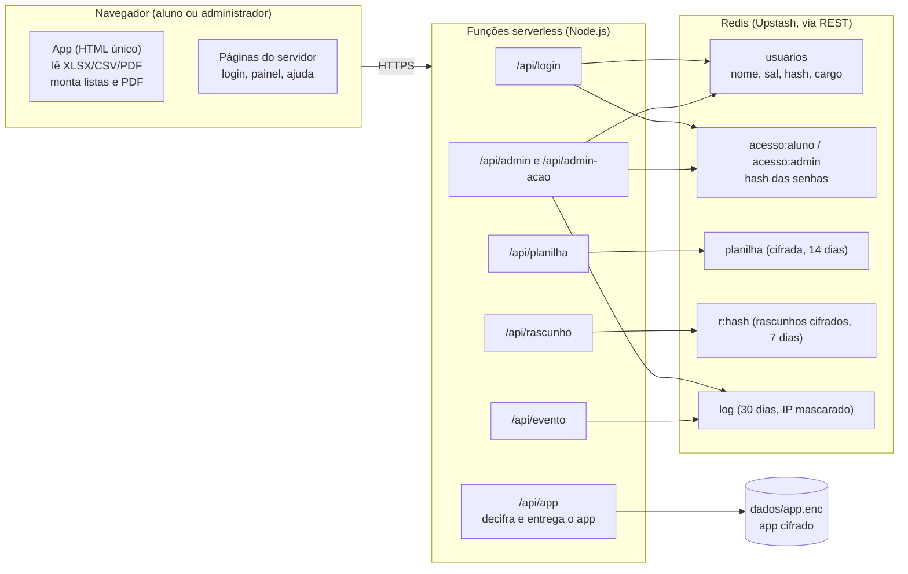

# Conferência CIAGA

Aplicação web para o **Centro de Instrução Almirante Graça Aranha (CIAGA / EFOMM)** que transforma a planilha semanal do municiamento (café da manhã, almoço, janta e ceia) em **listas de conferência** por dia, refeição e turma, prontas para marcar na tela, copiar, imprimir ou baixar em **PDF/DOCX**.

O repositório contém tudo o que é necessário para colocar o sistema no ar e para entender como ele se protege:

| Parte | Pasta | O que é |
|---|---|---|
| **Site** | `api/`, `public/`, `scripts/`, `vercel.json` | Servidor (funções serverless em Node.js), páginas de login/painel/ajuda e scripts de operação |
| **App** | `fonte-app/` | O aplicativo que roda no navegador: lê a planilha, monta as listas e gera PDF. É compilado em **um único HTML** |
| **Documentação** | `docs/` | Arquitetura, fluxos, segurança e criptografia (com diagramas) e guia de operação |

> **Resumo de segurança em uma frase:** só quem está numa lista de autorizados, com nome de guerra + número interno + senha da unidade, recebe o app; o app, a planilha publicada, os rascunhos e os códigos ficam **cifrados em repouso** (AES-256-GCM); o servidor confere o cargo da pessoa **no banco a cada ação**; e tudo o que é sensível pode ser rotacionado sem reescrever código.

---

## Sumário

1. [Visão geral](#1-visão-geral)
2. [Arquitetura](#2-arquitetura)
3. [Estrutura do repositório](#3-estrutura-do-repositório)
4. [Perfis e permissões](#4-perfis-e-permissões)
5. [Segurança em resumo](#5-segurança-em-resumo)
6. [Variáveis de ambiente](#6-variáveis-de-ambiente)
7. [Instalação e implantação](#7-instalação-e-implantação)
8. [Operação do dia a dia](#8-operação-do-dia-a-dia)
9. [Desenvolvimento e testes](#9-desenvolvimento-e-testes)
10. [Rotas e endpoints](#10-rotas-e-endpoints)
11. [Dados e privacidade (LGPD)](#11-dados-e-privacidade-lgpd)
12. [Limitações conhecidas](#12-limitações-conhecidas)
13. [Problemas comuns](#13-problemas-comuns)
14. [Regras de contribuição](#14-regras-de-contribuição)
15. [Mapa da documentação](#15-mapa-da-documentação)

---

## 1. Visão geral

### O problema
Os alunos "se municiam" (registram presença nas refeições) numa planilha. Alguém precisava abrir a planilha e montar, à mão, as listas de conferência que seriam impressas.

### O que o sistema faz
1. Um **administrador** abre o app, carrega a planilha da semana (XLSX recomendado, CSV ou PDF) e **publica**.
2. A planilha publicada é guardada **cifrada**; os alunos, ao entrarem, recebem-na já carregada.
3. O app separa por **dia, refeição e ano/curso**, em **ordem alfabética ou por antiguidade**, com a regra:
   - **Café da manhã:** mostra os **municiados**;
   - **Almoço e janta:** mostram os **não municiados**;
   - **Ceia, sábado e domingo:** ignorados nas listas.
4. A pessoa marca na tela quem está presente, filtra (**Todos / Municiados / NÃO municiados**) e **baixa** (PDF) ou **copia** a lista.
5. O trabalho é salvo automaticamente num **rascunho individual cifrado**, para continuar depois.
6. A **Conferência Geral** (todos os usuários) junta o que todas as pessoas que conferiram o mesmo dia e a mesma refeição marcaram, numa listagem única, sempre por antiguidade e por turma, com o filtro Todos / Municiados / NÃO municiados.
7. **Rancho corrido:** qualquer pessoa lê a autorização de rancho corrido e/ou o detalhe de serviço do dia (PDF, XLSX, CSV ou **foto**, com OCR no navegador) e publica; quem está nos arquivos aparece na marcação em **laranja**, com o selo **RANCHO CORRIDO**, e o motivo aparece ao tocar.
8. Os administradores acompanham o **registro de acessos** e gerenciam quem entra, tudo pelo painel `/admin`, **sem novo deploy**.

### Princípios de projeto
- **Mínimo de dados:** o arquivo original da planilha **não é guardado**; só o que o app leu (nomes, turmas, marcações), cifrado, por tempo limitado.
- **Defesa em profundidade:** cada camada (login, sessão, cargo, banco, criptografia, navegador) tem controles independentes.
- **Falha segura (fail-closed):** sem senha definida, ninguém entra naquele perfil; sem chave, nada é decifrado.
- **Sem dependências de terceiros no servidor:** só módulos nativos do Node.js (`crypto`, `zlib`, `fs`), o que reduz a superfície de ataque.
- **Operável por não programadores:** liberar pessoas, trocar senhas e remover a planilha são ações do painel.

---

## 2. Arquitetura



- **Hospedagem:** funções serverless (Vercel) + arquivos estáticos em `public/`. O roteamento está em [`vercel.json`](vercel.json).
- **Banco:** Redis serverless (Upstash) acessado por HTTPS (REST/pipeline). Guarda **só** o que está descrito em [docs/CRIPTOGRAFIA.md](docs/CRIPTOGRAFIA.md#6-o-que-existe-no-banco).
- **App:** um único HTML (~3,4 MB; ~1,1 MB comprimido) gerado por `fonte-app/web/build.mjs`, **cifrado** em `dados/app.enc` e entregue só depois da autenticação.
- **Sem estado no servidor:** a sessão vive num cookie assinado; os dados persistentes ficam no Redis.

Detalhes e diagramas de cada fluxo: [docs/ARQUITETURA_E_FLUXO.md](docs/ARQUITETURA_E_FLUXO.md).

---

## 3. Estrutura do repositório

```text
.
├── api/                         Funções serverless (uma por rota)
│   ├── _lib/
│   │   ├── seguranca.js         hashes, sessão assinada, CSRF, limites de tentativas
│   │   ├── cofre.js             criptografia dos dados no banco (AES-256-GCM + HKDF)
│   │   ├── pessoas.js           lista de pessoas, cargos, regras de ranchef/administradores
│   │   ├── acessos.js           senhas de acesso por perfil (aluno/administrador)
│   │   ├── registro.js          cliente do Redis e registro de eventos (IP mascarado)
│   │   └── layout.js            HTML das páginas do servidor e CSP
│   ├── login.js  sair.js  app.js  ajuda.js
│   ├── admin.js  admin-acao.js  admin-baixar.js
│   ├── planilha.js  planilha-ver.js  rascunho.js  evento.js  conferencia-geral.js
├── public/                      Páginas estáticas: login, tema claro/escuro, brasão, menu.css e ocr/ (Tesseract.js e português, para ler fotos)
├── scripts/
│   ├── cifrar.mjs               cifra o app (gera dados/app.enc)
│   ├── carregar-lista.mjs       carrega/restaura a lista de pessoas no banco
│   ├── hash-senha.mjs           gera hash para contas extras (opcional)
│   └── teste.mjs                42 testes do site (dados fictícios)
├── fonte-app/                   Código-fonte do app que roda no navegador
│   ├── web/  (src, estilo.css, build.mjs, vendor/, testes/)
│   ├── assets/  tests/fixtures/ (planilhas fictícias)  docs/  LEIA-ME.txt
├── docs/                        Documentação técnica (com diagramas)
├── dados/app.enc                (não versionado) app cifrado gerado por scripts/cifrar.mjs
├── vercel.json  package.json  .gitignore  .vercelignore
└── .github/workflows/testes.yml Roda os testes a cada pull request
```

---

## 4. Perfis e permissões

| Capacidade | Aluno | Administrador (até 2) | Ranchef (1) |
|---|:--:|:--:|:--:|
| Entrar, ver a planilha publicada, marcar, filtrar, copiar, baixar PDF | ✅ | ✅ | ✅ |
| Rascunho individual cifrado | ✅ | ✅ | ✅ |
| Abrir o painel `/admin` (entrando no modo **Administrador**) | ❌ | ✅ | ✅ |
| Publicar / remover a planilha da semana | ❌ | ✅ | ✅ |
| Liberar e excluir alunos | ❌ | ✅ | ✅ |
| Trocar a **senha dos alunos** | ❌ | ✅ | ✅ |
| Ver o registro de eventos (com filtros) e a planilha publicada (somente leitura) | ❌ | ✅ | ✅ |
| **Conferência Geral** (junta as marcações de todas as conferentes de um dia e refeição) | ✅ | ✅ | ✅ |
| **Rancho corrido**: ler e publicar os arquivos do dia | ✅ | ✅ | ✅ |
| Remover o rancho corrido de um dia (painel) | ❌ | ✅ | ✅ |
| Promover aluno a administrador / remover de administrador | ❌ | ❌ | ✅ |
| Trocar a **senha dos administradores** | ❌ | ❌ | ✅ |
| Baixar o backup da lista | ❌ | ❌ | ✅ |
| Passar o cargo de ranchef a outra pessoa (quem passa vira administrador) | ❌ | ❌ | ✅ |

Regras: um ranchef; no máximo 2 administradores; nomes de guerra únicos; **ninguém altera a si mesmo**; o cargo é conferido **no banco a cada ação** (quem é rebaixado ou excluído perde o poder na hora); a sessão de administrador dura **2 h** e a de aluno **12 h**; entrar como administrador é uma **escolha explícita** no login.

---

## 5. Segurança em resumo

| Camada | Controle |
|---|---|
| **Quem entra** | Lista de autorizados + **três fatores de conhecimento**: nome de guerra, número interno (letra + 4 dígitos) e senha da unidade (uma para alunos, outra para administradores) |
| **Armazenamento dos códigos** | `scrypt(HMAC-SHA256(PEPPER, código))` com sal por pessoa; comparação em tempo constante; mesmo custo para nome inexistente |
| **Sessão** | Cookie `HttpOnly; Secure; SameSite=Strict`, assinado com HMAC-SHA256, expira (12 h / 2 h) |
| **Autorização** | Cargo conferido ao vivo no banco; ações de administrador exigem o modo administrador; ações críticas pedem confirmação com o número interno |
| **Dados em repouso** | App, planilha publicada e rascunhos em **AES-256-GCM**; chaves derivadas por **HKDF** com *contexto* (um blob não serve em outro lugar) |
| **Força bruta** | Atraso de ~0,8 s por erro; **8 erros por dia por IP** → bloqueio de **15 min** e contador zerado; limites por pessoa nas ações sensíveis |
| **Navegador** | HTTPS com HSTS, CSP restrita (`connect-src 'self'`), `X-Frame-Options: DENY`, `nosniff`, `Referrer-Policy: same-origin`, `Cache-Control: no-store`, proteção CSRF (`Sec-Fetch-Site`/`Origin` + `SameSite=Strict`) |
| **Registro** | Quem, ação, horário, aparelho e **IP parcial**; guardado por **30 dias**; nunca registra senha, número interno ou dados da planilha |

Análise completa (modelo de ameaças, matriz de controles, rotação de segredos e riscos residuais): [docs/SEGURANCA.md](docs/SEGURANCA.md). Detalhes de cada primitiva criptográfica, formatos de bytes e hierarquia de chaves: [docs/CRIPTOGRAFIA.md](docs/CRIPTOGRAFIA.md).

---

## 6. Variáveis de ambiente

Configure no painel do provedor de hospedagem (Environment Variables). **Nunca** coloque valores no repositório.

| Variável | Obrigatória | Para que serve | Se trocar |
|---|:--:|---|---|
| `APP_KEY` | ✅ | 64 hex. Cifra/decifra `dados/app.enc` (o app) | É preciso refazer `dados/app.enc` com a nova chave e fazer deploy |
| `DATA_KEY` | ✅ | 64 hex. Chave-mestra (HKDF) da planilha publicada, dos rascunhos e do número interno exibido no painel | Planilha e rascunhos deixam de abrir (publique de novo); números internos voltam a aparecer a cada login ou ao rodar `carregar-lista` |
| `PEPPER` | ✅ | Segredo do HMAC dos números internos e senhas | **Nunca troque**: invalida todos os códigos (recarregue a lista) |
| `SESSION_SECRET` | ✅ | Assina os cookies de sessão | Derruba todas as sessões abertas |
| `ACCESS_CODE` | ✅* | Senha inicial dos **alunos** | Pode ser trocada depois pelo painel (o valor do painel prevalece) |
| `ACCESS_CODE_ADMIN` | ✅* | Senha inicial dos **administradores** | Idem |
| `KV_REST_API_URL`, `KV_REST_API_TOKEN` | ✅ | Acesso ao Redis (criadas ao conectar o banco) | Trocar o token no provedor e aqui |
| `RANCHEF_INICIAL` | ➖ | Nome de guerra do ranchef de origem (padrão: `Gordilho`). Se o banco estiver sem ranchef, essa pessoa assume no login | — |
| `USERS` | ➖ | Contas extras da equipe (`scripts/hash-senha.mjs`) | — |
| `APP_ENC_PATH` | ➖ | Caminho alternativo do `app.enc` (usado em testes) | — |

\* Sem senha definida (nem por variável, nem pelo painel), **ninguém entra naquele perfil**.

Gerar um segredo de 64 hex:

```bash
node -e "console.log(require('crypto').randomBytes(32).toString('hex'))"
```

Use valores **diferentes** para `APP_KEY`, `DATA_KEY`, `PEPPER` e `SESSION_SECRET`, e guarde-os num gerenciador de senhas.

---

## 7. Instalação e implantação

Requisitos: **Node.js ≥ 20**, conta no provedor de hospedagem e um banco Redis (plano gratuito do Upstash é suficiente).

```bash
# 1. gerar o app a partir do código-fonte
npm run app:build                       # cria fonte-app/conferencia_digital.html

# 2. cifrar o app (APP_KEY = a mesma variável de ambiente do servidor)
APP_KEY=<64 hex> node scripts/cifrar.mjs fonte-app/conferencia_digital.html   # cria dados/app.enc

# 3. publicar
npx vercel --prod
```

Em PowerShell: `$env:APP_KEY="<64 hex>"; node scripts/cifrar.mjs fonte-app/conferencia_digital.html`.

**Primeira carga da lista de pessoas** (no seu computador; nada é gravado em disco):

```powershell
$env:KV_REST_API_URL="..."; $env:KV_REST_API_TOKEN="..."; $env:PEPPER="..."; $env:DATA_KEY="..."
node scripts/carregar-lista.mjs ..\AUTORIZADOS.txt
```

`AUTORIZADOS.txt` fica **fora do repositório**: uma pessoa por linha, `nome;número_interno`, `nome;número_interno;admin` ou `nome;número_interno;ranchef`; `#` comenta; nomes únicos; no máximo 1 ranchef e 2 administradores. Quem já existe no banco não é alterado (só é completado o código cifrado exibido no painel).

Passo a passo completo, incluindo domínio e uso no iPhone: [docs/OPERACAO.md](docs/OPERACAO.md).

---

## 8. Operação do dia a dia

Tudo em `/admin`, sem deploy:

- liberar/excluir alunos; promover/remover administradores (ranchef);
- **trocar as senhas** de alunos e administradores (recomendado: **a cada 30 dias**; o painel avisa);
- publicar/remover a planilha; **visualizar** a planilha publicada (somente leitura, em tabela, também quando o arquivo original era PDF);
- consultar o **registro de eventos**, com filtro por nome/número interno e a opção **"Só tentativas recusadas"**;
- passar o cargo de ranchef (quem passa vira administrador);
- baixar o **backup** da lista (ranchef) e restaurá-lo com `scripts/carregar-lista.mjs`.

Rotina sugerida, em [docs/OPERACAO.md](docs/OPERACAO.md#rotina-recomendada).

---

## 9. Desenvolvimento e testes

> **Limite de funções:** o plano gratuito da Vercel aceita no máximo **12 funções** (`api/*.js`, sem contar `_lib/`). Hoje são 12; um teste avisa se passar disso. Para criar uma rota nova, junte duas existentes (como `admin-baixar.js`, que reúne a lista e o backup) ou use um plano pago.

### Testar o site no seu computador, sem deploy

```bash
npm run local        # abre http://localhost:4174
```

Sobe o site completo (login, painel, app, Conferência Geral) com um **Redis falso em memória**, chaves aleatórias e **pessoas fictícias** (Alfa/ranchef `B1901`, Bravo/administrador `B1902`, Charlie `B1903` e Delta `B1904`). As senhas de teste aparecem no terminal. Nada é gravado em disco e tudo some ao fechar. Para ver a Conferência Geral: entre como **Alfa** em modo Administrador, carregue a planilha de exemplo (`fonte-app/tests/fixtures/ficticio.xlsx`, também em `http://localhost:4174/_exemplo.xlsx`), publique e abra `http://localhost:4174/_demo`. Para regerar o app depois de mudar o código-fonte: `npm run local -- --build`.

**Testar a leitura de uma foto sua (sem enviar a lugar nenhum):** `FOTO_TESTE=C:\caminho\foto.jpg npm run local` (no PowerShell: `$env:FOTO_TESTE="C:\caminhooto.jpg"; npm run local`) serve a foto só no seu computador em `/_foto-teste`. No navegador, `Municiamento.linhasDaFoto(bytes, "jpeg")` mostra o que o OCR enxergou, linha a linha.

**Auditoria de layout (celular e computador, tema claro e escuro):** com o servidor local aberto e a página em qualquer tela, carregue `/_auditoria.js` e rode `await auditarNosDoisTemas()` no console. Ela procura rolagem horizontal, caixas coladas, texto sobre texto, texto que escapa de botões, texto cortado, alvos de toque pequenos e letras pequenas. Em uma página logada como administrador, `await percorrerApp()` percorre as telas do app (lista, marcação, rela, Conferência Geral, Rancho corrido) e audita cada uma. O resultado esperado é uma lista vazia.

```bash
npm run teste        # 42 testes do site (api/): autenticação, cargos, cofre, painel, limites...
npm run app:teste    # 36 testes do app (parser, regras de lista, relatório, hospedado)
npm run teste:tudo   # os dois
npm run app:build    # gera fonte-app/conferencia_digital.html
```

- Os testes do site usam um **Redis falso em memória** e **dados fictícios** (nomes e números inventados).
- Os testes do app usam as planilhas **fictícias** de `fonte-app/tests/fixtures/`.
- O fluxo `.github/workflows/testes.yml` roda tudo em cada pull request.
- Sem dependências npm de produção: o `package.json` só define scripts.

---

## 10. Rotas e endpoints

| Rota | Método | Acesso | Função |
|---|---|---|---|
| `/` | GET | público | Tela de login |
| `/api/login` | POST | público (com limites) | Confere os três fatores e abre a sessão |
| `/app` → `/api/app` | GET | sessão | Decifra e entrega o app (com menu, rodapé e perfil injetados) |
| `/sair` → `/api/sair` | GET | sessão | Encerra a sessão |
| `/ajuda` → `/api/ajuda` | GET | sessão | "Como usar" (seções de administrador só para administradores) |
| `/admin` → `/api/admin` | GET | administrador (modo admin) | Painel |
| `/admin/planilha` → `/api/planilha-ver` | GET | administrador | Visualizador da planilha publicada (somente leitura) |
| `/api/admin-acao` | POST | administrador (algumas só ranchef) | Cadastrar, excluir, promover, rebaixar, trocar senhas, transferir/assumir ranchef, remover planilha |
| `/api/admin-lista` (→ `api/admin-baixar?o=lista`) | GET | administrador | Lista de liberados (.txt), sem códigos |
| `/api/admin-exportar` (→ `api/admin-baixar?o=backup`) | GET | ranchef | Backup da lista (JSON: nomes, sais, hashes) |
| `/api/planilha` | GET / POST / DELETE | GET: sessão · POST/DELETE: administrador | Lê, publica ou remove a planilha cifrada |
| `/api/rascunho` | GET / PUT / DELETE | sessão (individual) | Rascunho cifrado do próprio usuário |
| `/api/planilha?rancho=` | GET / POST | sessão (qualquer perfil) | Rancho corrido do dia: lê os dias pedidos / publica (só acrescenta), cifrado por dia |
| `/api/conferencia-geral` | GET | sessão (qualquer perfil) | Sem parâmetros: dias e refeições com conferentes. Com `dia` e `refeicao`: conferentes e união das marcações |
| `/api/evento` | POST | sessão | Eventos permitidos (carregou planilha, baixou PDF), lista fechada |

---

## 11. Dados e privacidade (LGPD)

| Dado | Onde | Protegido por | Retenção |
|---|---|---|---|
| Nome de guerra, cargo | Redis (`usuarios`) | Acesso ao banco restrito | Até exclusão pelo administrador |
| Número interno / senhas | Redis | Hash (scrypt + HMAC/PEPPER) e, para exibição no painel, AES-256-GCM | Idem |
| Planilha lida (nomes, turmas, marcações) | Redis (`planilha`) | AES-256-GCM | 14 dias (ou remoção manual) |
| Rascunho de marcações | Redis (`r:…`) | AES-256-GCM, chave por pessoa (contexto) | 7 dias, renovado ao salvar |
| Registro de acessos | Redis (`log`) | IP mascarado | 30 dias |
| Arquivo original da planilha | **não é guardado** | — | — |

Avise os usuários de que os acessos são registrados (IP parcial, horário e ações).

---

## 12. Limitações conhecidas

- Quem está autorizado recebe o app e os dados **em claro no navegador**: a criptografia protege o que está hospedado, não contra o usuário autorizado (foto de tela, compartilhamento de senha).
- Os contadores de tentativas ficam **na memória de cada instância** serverless; um atacante pode cair em instâncias diferentes. Ative também o *rate limit* do firewall do provedor em `/api/login`.
- O número interno (letra + 4 dígitos) tem poucas combinações; a proteção vem das **três** informações juntas, do limite de tentativas e do `PEPPER`.
- O código selado exibido no painel usa um contexto fixo (`codigo`), não amarrado à pessoa; um atacante com **escrita** no banco poderia trocar blobs entre pessoas (sem conseguir lê-los).
- Se o banco ficar indisponível, ninguém entra (o login depende dele); o app continua cifrado e seguro.
- Não houve auditoria de segurança externa.

Lista completa em [docs/SEGURANCA.md](docs/SEGURANCA.md#9-riscos-residuais-e-limitações).

---

## 13. Problemas comuns

| Sintoma | Causa provável | O que fazer |
|---|---|---|
| "Nome, número interno ou senha incorretos" | Um dos três campos errado, ou perfil errado (aluno × administrador) | Conferir os campos; administradores usam a **senha de administrador** |
| "Muitas tentativas erradas" | 8 erros no dia no mesmo IP | Aguardar 15 minutos |
| Ninguém entra como aluno | Senha dos alunos não definida (variável ausente ou com nome errado) | Definir `ACCESS_CODE` ou trocar pelo painel |
| Planilha publicada "não abre" | `DATA_KEY` trocada | Publicar a planilha de novo |
| Painel sem números internos | Pessoas cadastradas antes do recurso | Rodar `carregar-lista.mjs` ou aguardar o login de cada pessoa |
| Página do app em branco | `dados/app.enc` ausente ou cifrado com outra `APP_KEY` | Refazer o passo de cifragem e o deploy |

---

## 14. Regras de contribuição

- **Nunca** versionar: planilhas reais, `AUTORIZADOS.txt`, backups da lista, `dados/app.enc`, `.env`, bancos `.db`, listas geradas (PDFs com nomes). O `.gitignore` já bloqueia esses arquivos; **não o enfraqueça**.
- Testes usam **somente dados fictícios**.
- Antes de cada commit: `git status` e `git diff --cached --stat`.
- Commits pequenos, em português, no imperativo (ex.: `Adiciona visualizador da planilha`); uma branch por assunto e *pull request* com resumo do que mudou e do que foi testado.
- Se algo sensível for enviado por engano, trate como **exposto**: remova do histórico e troque os segredos.

---

## 15. Mapa da documentação

| Documento | Conteúdo |
|---|---|
| [docs/ARQUITETURA_E_FLUXO.md](docs/ARQUITETURA_E_FLUXO.md) | Componentes, modelo de dados, todos os fluxos (login, app, planilha, rascunho, painel, ranchef, registro) com diagramas |
| [docs/SEGURANCA.md](docs/SEGURANCA.md) | Modelo de ameaças, fronteiras de confiança, autenticação, sessão, autorização, limites, cabeçalhos, registro, rotação de segredos, riscos residuais |
| [docs/CRIPTOGRAFIA.md](docs/CRIPTOGRAFIA.md) | Hierarquia de chaves, algoritmos e parâmetros, formatos de bytes, o que existe no banco, efeitos de cada rotação |
| [docs/OPERACAO.md](docs/OPERACAO.md) | Implantação passo a passo, rotina dos administradores, backup, manutenção |
| [Implementações.md](Implementações.md) | Funcionalidades planejadas e em andamento, com regras e decisões |
| [fonte-app/LEIA-ME.txt](fonte-app/LEIA-ME.txt) | Estrutura e geração do app do navegador |
