# Arquitetura e fluxos

Este documento descreve **como o sistema é composto e como cada fluxo funciona**, com diagramas. Os detalhes de segurança estão em [SEGURANCA.md](SEGURANCA.md) e os de criptografia em [CRIPTOGRAFIA.md](CRIPTOGRAFIA.md). Os diagramas usam [Mermaid](https://mermaid.js.org/), renderizado nativamente pelo GitHub.

## Sumário

1. [Componentes](#1-componentes)
2. [Modelo de dados no Redis](#2-modelo-de-dados-no-redis)
3. [Ciclo de vida de uma sessão](#3-ciclo-de-vida-de-uma-sessão)
4. [Fluxo de login](#4-fluxo-de-login)
5. [Entrega do app](#5-entrega-do-app)
6. [Pipeline do app no navegador](#6-pipeline-do-app-no-navegador)
7. [Publicar e carregar a planilha](#7-publicar-e-carregar-a-planilha)
8. [Rascunho automático](#8-rascunho-automático)
9. [Ações de administrador](#9-ações-de-administrador)
10. [Cargos: ranchef, administradores e transferência](#10-cargos-ranchef-administradores-e-transferência)
11. [Senhas de acesso (troca pelo painel)](#11-senhas-de-acesso-troca-pelo-painel)
12. [Registro de eventos](#12-registro-de-eventos)
13. [Pipeline de build e implantação](#13-pipeline-de-build-e-implantação)
14. [Tratamento de falhas](#14-tratamento-de-falhas)
15. [Conferência Geral](#15-conferência-geral)
16. [Menu suspenso do cabeçalho](#16-menu-suspenso-do-cabeçalho)

---

## 1. Componentes

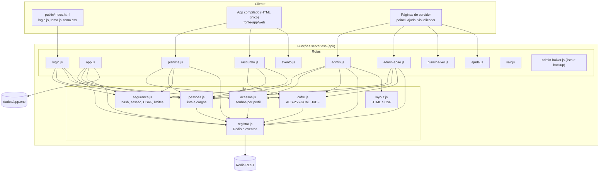

| Componente | Responsabilidade | Observação |
|---|---|---|
| `api/_lib/seguranca.js` | Hashes (scrypt + HMAC), cookie assinado, `lerSessao`, `mesmaOrigem` (CSRF), limitadores | Usa só `crypto` do Node |
| `api/_lib/cofre.js` | Cifra/decifra o que vai ao Redis (planilha, rascunho, código selado) | HKDF por contexto + AES-256-GCM + gzip |
| `api/_lib/pessoas.js` | CRUD da lista de pessoas, regras de cargos, ranchef, backup | Estado no hash Redis `usuarios` |
| `api/_lib/acessos.js` | Senha de acesso por perfil (hash no banco ou variável de ambiente) | Falha fechada |
| `api/_lib/registro.js` | Cliente REST do Redis, registro de eventos, máscara de IP | Retenção de 30 dias |
| `api/_lib/layout.js` | HTML das páginas do servidor e a CSP rígida delas | `default-src 'none'` |
| `fonte-app/web` | Leitura de XLSX/CSV/PDF, regras de lista, relatório, PDF, modo hospedado | Compilado em um único HTML |

---

## 2. Modelo de dados no Redis

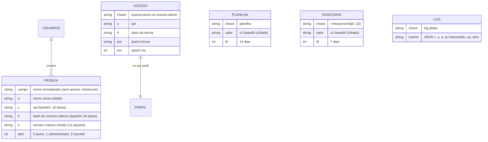

| Chave Redis | Tipo | Conteúdo | Expira |
|---|---|---|---|
| `usuarios` | hash | campo = nome normalizado; valor = JSON `{d, s, h, k, adm}` | não |
| `acesso:aluno`, `acesso:admin` | string | JSON `{s, h, por, em}` (hash da senha, sem o texto) | não |
| `planilha` | string | blob cifrado `v1.…` com a planilha empacotada | 14 dias |
| `r:<32 hex>` | string | blob cifrado `v1.…` com o rascunho da pessoa | 7 dias (renovado ao salvar) |
| `log` | lista | eventos JSON, do mais novo ao mais antigo (máx. 5.000) | itens com mais de 30 dias são removidos no login |

A planilha empacotada (antes de cifrar) é um objeto `v:1` com `formato`, `sexta`, `turmas`, `avisos` e `alunos` (`[nome, número interno, turma, máscara de 28 bits]`, um bit por dia × refeição).

---

## 3. Ciclo de vida de uma sessão

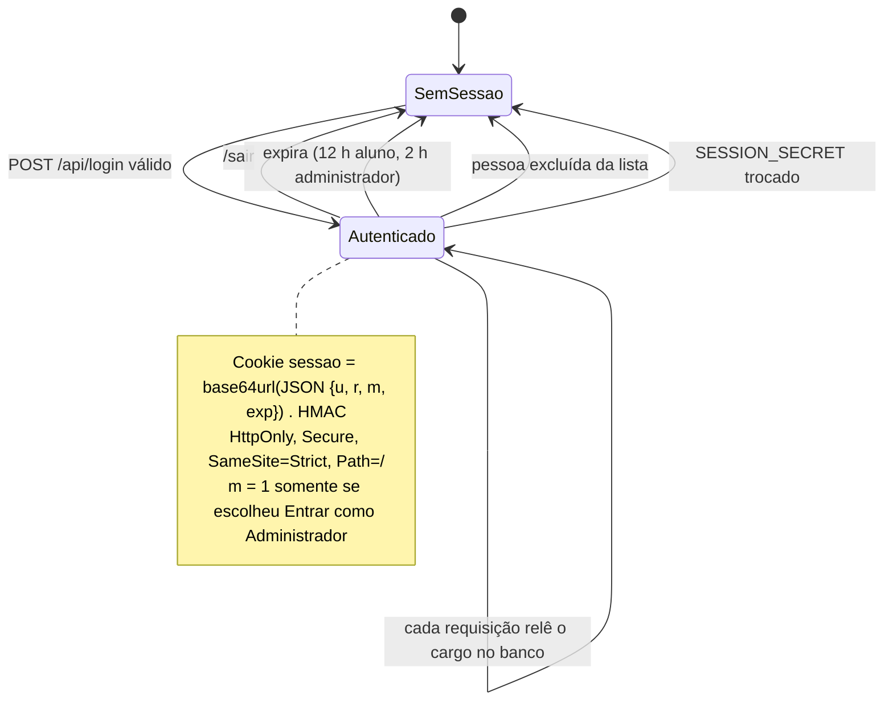

O cookie guarda um **papel de reserva** (`r`), mas as decisões de autorização usam o **cargo atual do banco** (`papelAtual`). Se o banco estiver indisponível, o servidor recorre ao cargo do cookie assinado só para decisões de leitura; ações que gravam dependem do banco de qualquer modo.

---

## 4. Fluxo de login

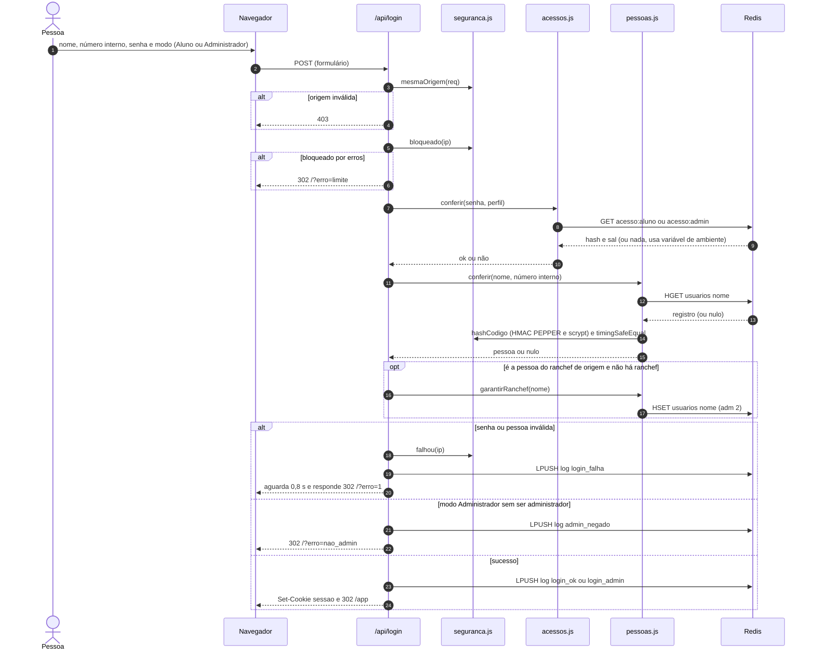

Pontos de projeto:

- A mensagem de erro **não diz qual dos três campos** falhou.
- A conferência do número interno tem o **mesmo custo** (scrypt) mesmo quando o nome não existe (`SAL_FALSO`/`HASH_FALSO`), evitando enumeração de usuários por tempo de resposta.
- O IP completo é usado **só em memória** para o limite de tentativas; o que vai ao registro é o IP **mascarado**.
- O registro grava **apenas o nome digitado** (limpo de caracteres de controle), nunca a senha nem o número interno.

---

## 5. Entrega do app

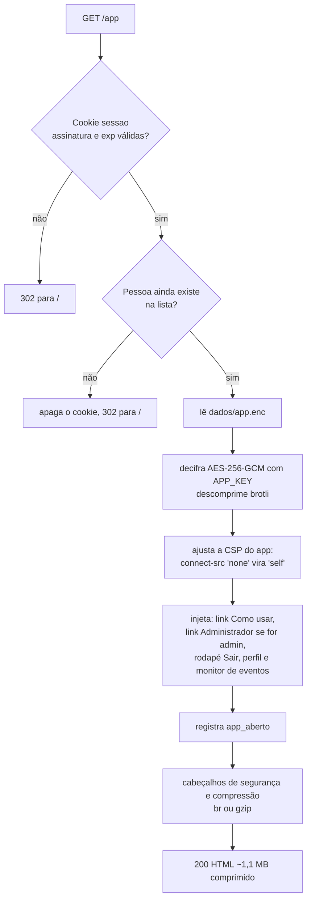

- O app **nunca** é servido como arquivo estático: o `dados/app.enc` só é decifrado em memória, após a autenticação.
- O perfil injetado (`Municiamento.HOSPEDADO`) serve **apenas para mostrar ou esconder telas**; quem de fato pode publicar é conferido no servidor a cada requisição.
- A inserção em pontos do HTML usa **âncoras do próprio app** (o HTML embute bibliotecas com `</body>` e `</main>` dentro de texto de código).

---

## 6. Pipeline do app no navegador

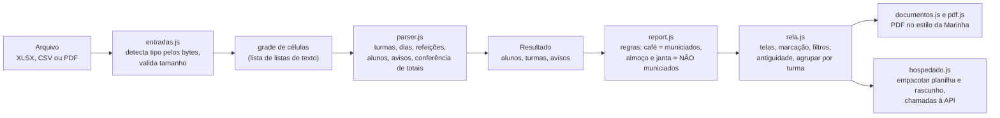

Princípios do app:

- **Um único parser de grade**: a lógica de negócio não depende do formato de entrada (CSV, XLSX ou PDF são convertidos para a mesma grade).
- **O mapa de colunas é por posição** (cada dia abre um grupo de 4 colunas: Café, Almoço, Janta, Ceia), porque os rótulos têm erros de digitação.
- **Divergências viram avisos**, nunca bloqueios (por exemplo, totais da planilha que não batem com a contagem).
- As bibliotecas pesadas (`pdf.js`, `xlsx`, `jspdf`, `jszip`) são carregadas **sob demanda**, depois da abertura, para o app abrir rápido no celular.
- O app é compilado por `fonte-app/web/build.mjs` num **único HTML** com CSP `default-src 'none'` (ajustada para `'self'` no servidor por causa do monitor de eventos).

---

## 7. Publicar e carregar a planilha

### Publicar (somente administrador)

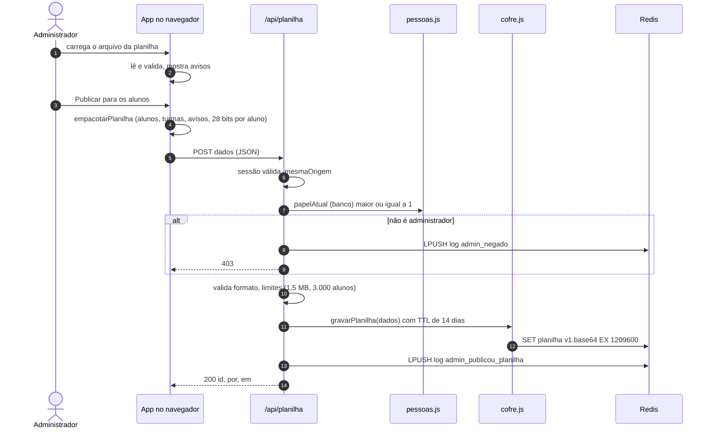

### Carregar (todo usuário autenticado)

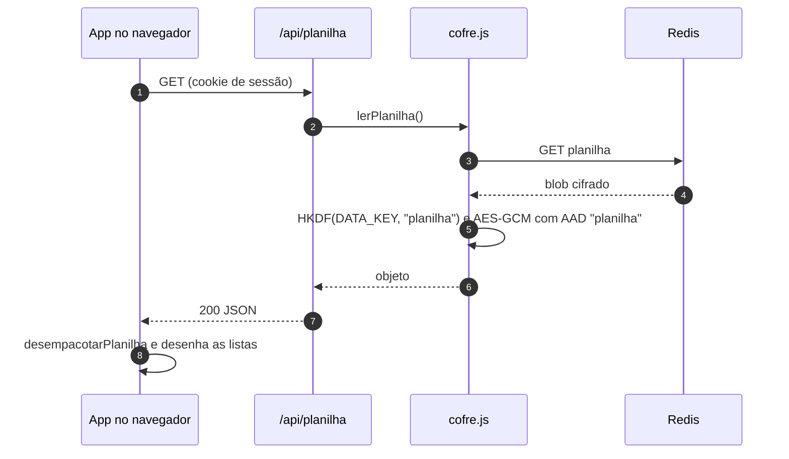

- O **arquivo original não é enviado nem guardado**: só o resultado da leitura, empacotado.
- Se a planilha original era **PDF**, o conteúdo publicado já é a versão convertida em tabela; o **visualizador** (`/admin/planilha`) mostra exatamente isso, em modo só leitura, para o administrador conferir.
- A planilha **expira sozinha em 14 dias** e pode ser removida a qualquer momento pelo painel.

---

## 8. Rascunho automático

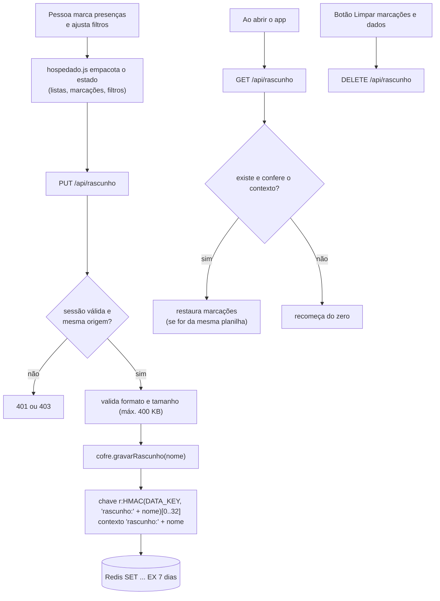

- O rascunho é **individual**: a chave do banco e o contexto de cifragem dependem do nome da pessoa; ninguém lê o rascunho de outra pessoa pela API.
- A **chave do banco não contém o nome** (é um HMAC dele): quem olha o Redis não sabe quem tem rascunho.
- Salvar o rascunho **não gera evento** no registro.
- Um rascunho adulterado ou de outra chave nunca trava a pessoa: o `GET` devolve "vazio".

---

## 9. Ações de administrador

Todas passam por `POST /api/admin-acao`.

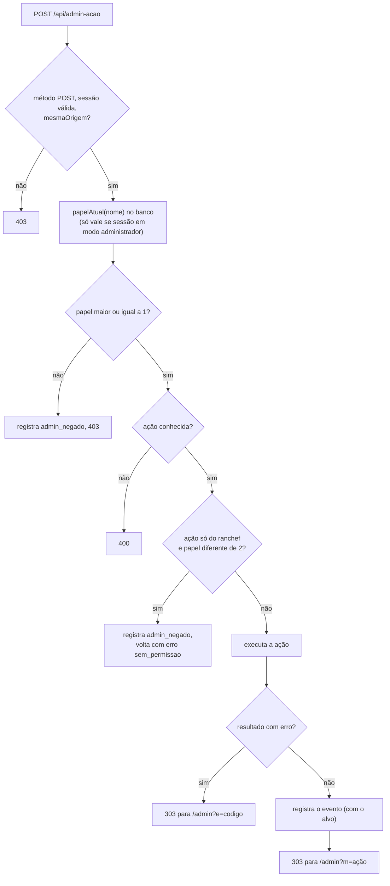

| Ação | Quem | Regras principais |
|---|---|---|
| `cadastrar` | admin, ranchef | Nome único; número interno `[BMN]\d{4}`; limite de 500 pessoas |
| `remover` | admin, ranchef | Só aluno; administrador precisa ser rebaixado antes; ninguém se exclui |
| `promover` | ranchef | Máx. 2 administradores; reconferência para cliques simultâneos |
| `rebaixar` | ranchef | Não vale para o ranchef nem para si mesmo |
| `limpar_planilha` | admin, ranchef | Apaga a chave `planilha` |
| `codigo_aluno` | admin, ranchef | Senha nova 2×, 8–64 caracteres, confirma com o número interno de quem troca; 5 tentativas/15 min |
| `codigo_admin` | ranchef | Idem; precisa ser diferente da senha dos alunos |
| `transferir_ranchef` | ranchef | Troca atômica de cargos; confirma com o número interno |
| `assumir_ranchef` | administrador | Só quando **não há** ranchef |

---

## 10. Cargos: ranchef, administradores e transferência

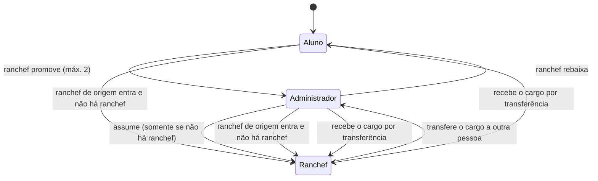

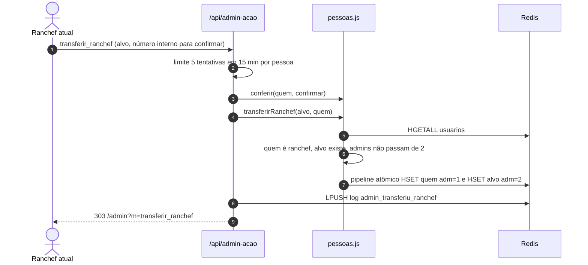

Invariantes: **exatamente um ranchef** (ou nenhum, antes da primeira atribuição), **no máximo dois administradores** além dele, e a troca de cargos é feita **num único pipeline** para nunca haver dois ranchefs nem nenhum no meio da operação.

**Ranchef de origem:** no login, se **não existe ranchef** e a pessoa que entrou é a designada (`RANCHEF_INICIAL`, padrão `Gordilho`), ela é promovida automaticamente. Depois que existe um ranchef, essa regra **não faz nada** (quem recebeu o cargo por transferência não o perde).

---

## 11. Senhas de acesso (troca pelo painel)

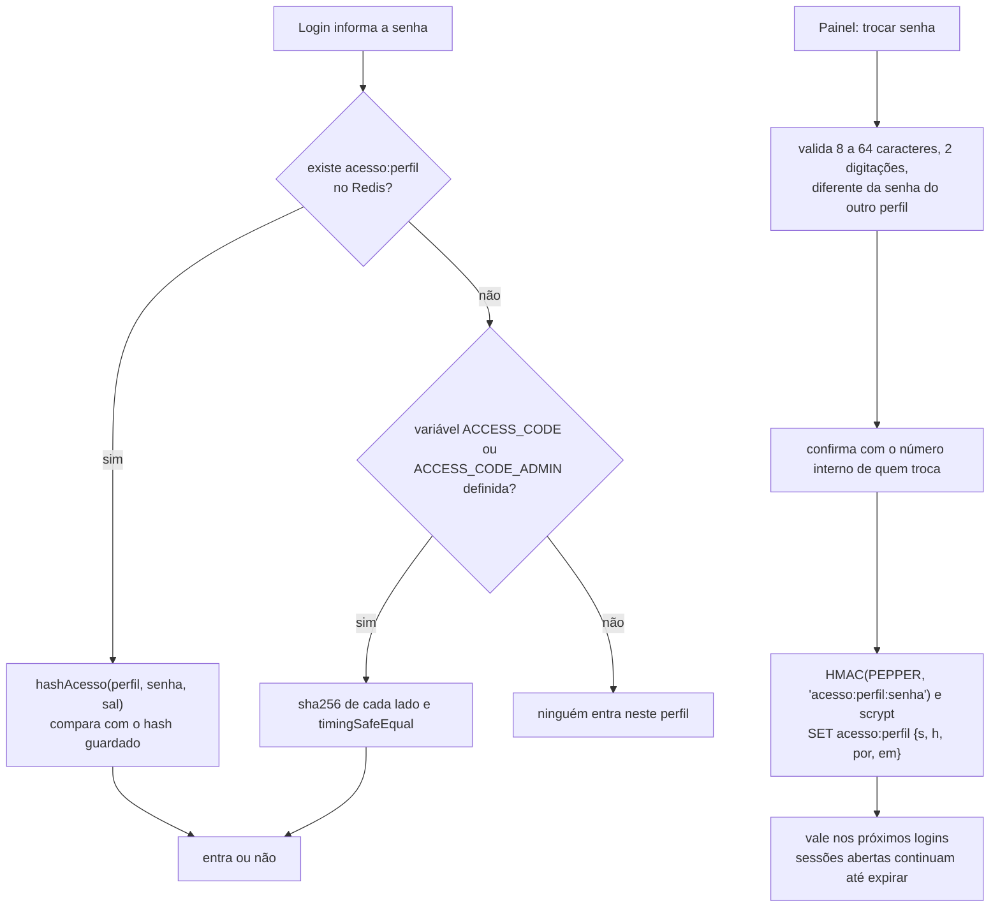

O painel mostra **quando** a senha foi trocada e há quantos dias, e avisa para trocá-la **a cada 30 dias**.

---

## 12. Registro de eventos

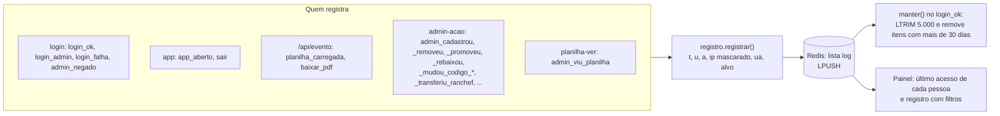

- `/api/evento` só aceita **três ações** de uma lista fechada: o navegador **não consegue gravar texto livre** no registro.
- O painel filtra por **nome de guerra** (sem acento/maiúscula) ou **número interno** (traduzido para o nome apenas para alunos) e tem a opção **"Só tentativas recusadas"** (`login_falha` e `admin_negado`).
- As consultas ao painel (`admin_consulta`) **não** aparecem na lista.

---

## 13. Pipeline de build e implantação

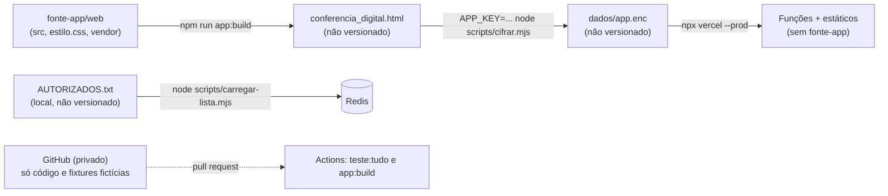

O que **entra** no deploy: `api/`, `public/`, `dados/app.enc`, `vercel.json`. O que **fica fora** (`.vercelignore`): `fonte-app/`, planilhas e documentos gerados.

---

## 14. Tratamento de falhas

| Falha | Comportamento |
|---|---|
| Redis indisponível no login | A conferência falha → o login é recusado (fail-closed); nada é concedido |
| Redis indisponível numa ação de administrador | A ação não é executada; o painel mostra mensagem de erro genérica |
| Redis indisponível ao registrar eventos | A falha é registrada no log do servidor e **não** impede o uso |
| `SESSION_SECRET` ausente | Qualquer cookie é tratado como "sem sessão" |
| `DATA_KEY` ausente ou inválida | Planilha e rascunhos não abrem (erro tratado: rascunho vira "vazio") |
| `APP_KEY` incorreta | `/app` responde 500 "Erro interno" (a autenticação do GCM falha) |
| Planilha adulterada no banco | O GCM rejeita (tag inválida): erro tratado, nada é exibido |
| Senha de um perfil não definida | Ninguém entra naquele perfil; o painel exibe um aviso em destaque |

---

## 15. Conferência Geral

Cruza o trabalho de **todas as pessoas que conferiram** o mesmo dia e a mesma refeição, produzindo **uma listagem única**. Qualquer pessoa autenticada usa (aluno ou administrador).

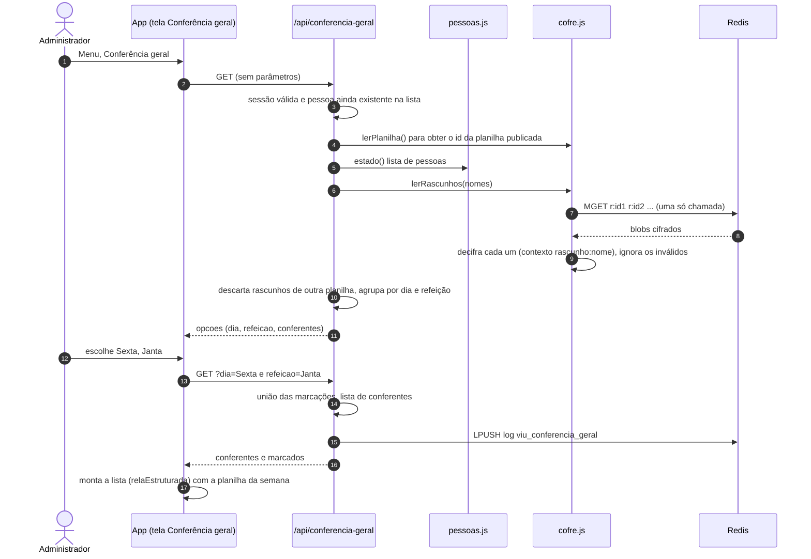

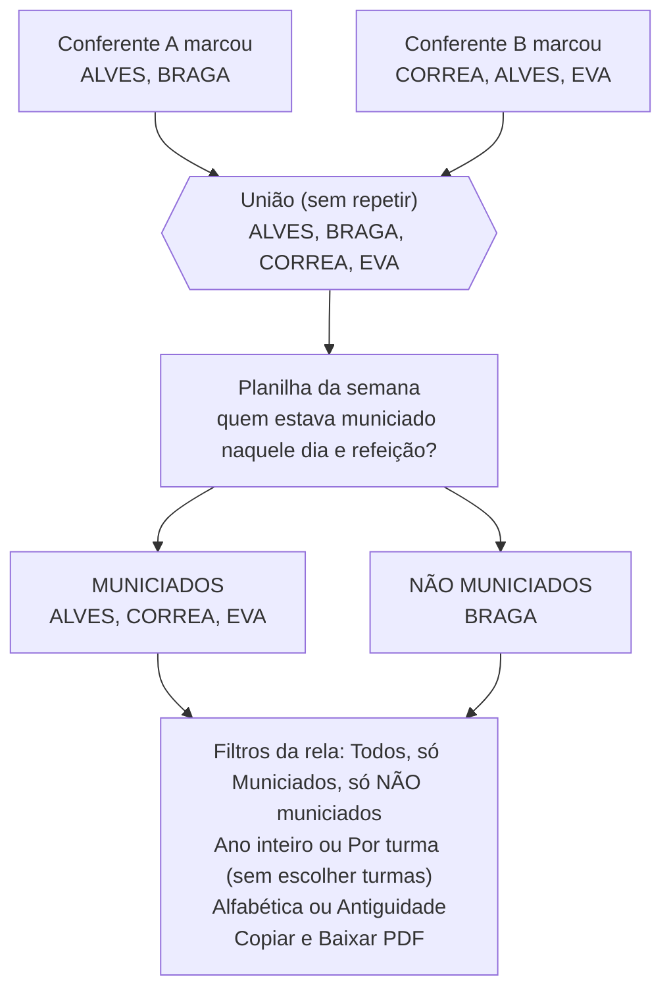

**Regras**

| Ponto | Comportamento |
|---|---|
| Cruzamento | **União**: um aluno consta se **qualquer** conferente o marcou; marcado por vários aparece **uma vez** |
| Listas em andamento | Entram todas as listas com pelo menos uma marcação; a tela mostra quantas estão finalizadas |
| Planilha | Só rascunhos feitos **na planilha publicada agora** (o rascunho guarda o id da planilha) |
| Separação | Pela planilha, como na rela individual: marcado e municiado → Municiados; marcado e não municiado → NÃO municiados |
| Quem aparece como conferente | Nome, quantas listas, quantos marcados e **quando salvou** (`salvoEm`, gravado pelo servidor a cada salvamento) |
| Persistência | **Nada é guardado**: a união é calculada a cada consulta e devolvida; os rascunhos continuam cifrados e individuais |
| Acesso | Qualquer sessão válida (aluno ou administrador); consulta registrada como `viu_conferencia_geral` |

**Detalhe de segurança:** os rascunhos são decifrados **no servidor**, que tem a `DATA_KEY`; é a única parte do sistema que lê rascunhos de várias pessoas, e devolve só o resultado agregado (nunca o rascunho bruto), a uma pessoa autenticada. As chaves dos rascunhos continuam sendo HMAC dos nomes (o banco não revela quem salvou o quê). Ver [SEGURANCA.md](SEGURANCA.md).

---

## 16. Menu suspenso do cabeçalho

O cabeçalho agrupa os links num único menu (`
`), igual nas páginas do servidor e no app:

| Contexto | Itens |
|---|---|
| App (aluno) | Conferência geral, Como usar |
| App (administrador) | Conferência geral, Administrador, Como usar |
| Painel e demais páginas do servidor | Voltar ao app (ou ao painel), Como usar |

**Uma só fonte de estilo:** `public/menu.css` (menu suspenso, cabeçalho em toda a largura e botão Sair). As páginas do servidor o carregam por `<link>` e o servidor o injeta no `<head>` do app, liberando `style-src 'self'` na regra do app; assim o menu fica certo mesmo com um `app.enc` mais antigo. O botão de tema e "Nova planilha" ficam fora do menu. O menu abre e fecha por clique ou teclado, fecha ao clicar fora ou com `Esc` e não aparece na impressão. O item "Conferência geral" tem `data-abrir-geral`: o app o intercepta e abre a tela **sem recarregar a página**.
