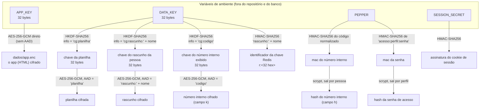
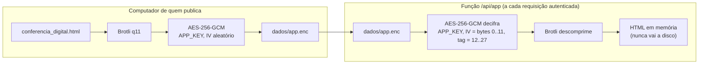
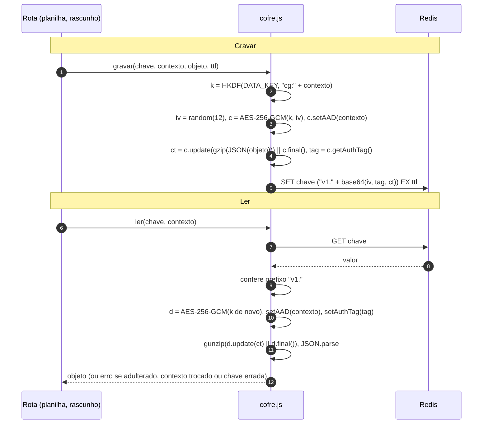

# Criptografia

Este documento descreve **todas as primitivas criptográficas** do sistema, os parâmetros, os formatos de bytes, a hierarquia de chaves e o efeito da rotação de cada segredo. Tudo usa o módulo nativo `crypto` do Node.js (OpenSSL); **não há bibliotecas criptográficas de terceiros** no servidor.

## Sumário

1. [Visão geral e segredos](#1-visão-geral-e-segredos)
2. [Hierarquia de chaves](#2-hierarquia-de-chaves)
3. [O app em repouso (`APP_KEY`)](#3-o-app-em-repouso-app_key)
4. [O cofre dos dados (`DATA_KEY`)](#4-o-cofre-dos-dados-data_key)
5. [Hashes de números internos e senhas (`PEPPER`)](#5-hashes-de-números-internos-e-senhas-pepper)
6. [O que existe no banco](#6-o-que-existe-no-banco)
7. [Sessão assinada (`SESSION_SECRET`)](#7-sessão-assinada-session_secret)
8. [Comparações em tempo constante](#8-comparações-em-tempo-constante)
9. [Transporte (TLS)](#9-transporte-tls)
10. [Rotação e recuperação](#10-rotação-e-recuperação)
11. [Propriedades verificadas pelos testes](#11-propriedades-verificadas-pelos-testes)
12. [Limitações e decisões de projeto](#12-limitações-e-decisões-de-projeto)

---

## 1. Visão geral e segredos

| Segredo | Tamanho | Onde vive | Protege | Primitiva |
|---|---|---|---|---|
| `APP_KEY` | 32 bytes (64 hex) | Variável de ambiente do servidor e no momento da cifragem (computador do desenvolvedor) | O app (`dados/app.enc`) | AES-256-GCM (chave direta) |
| `DATA_KEY` | 32 bytes (64 hex) | Variável de ambiente do servidor (e no computador ao rodar `carregar-lista`) | Planilha, rascunhos e número interno exibido no painel; também a chave dos identificadores de rascunho | HKDF-SHA256 → AES-256-GCM; HMAC-SHA256 |
| `PEPPER` | string longa | Variável de ambiente do servidor | Hashes de números internos e de senhas no banco | HMAC-SHA256 + scrypt |
| `SESSION_SECRET` | string longa | Variável de ambiente do servidor | Cookie de sessão | HMAC-SHA256 |
| Token do Redis | — | Variável de ambiente | Acesso ao banco | Bearer (HTTPS) |

**Princípio:** o banco e o repositório **nunca** contêm as chaves; o servidor as lê do ambiente. Quem obtiver só o banco (ou só o repositório) obtém apenas blobs cifrados e hashes.

---

## 2. Hierarquia de chaves



A separação de **uma chave por contexto** (HKDF com `info` distinto) e o **AAD** (dados autenticados associados) garantem que um blob cifrado para um fim **não seja aceito em outro** (ver [§4](#4-o-cofre-dos-dados-data_key)).

---

## 3. O app em repouso (`APP_KEY`)

Arquivo: `scripts/cifrar.mjs` (cifra) e `api/app.js` (decifra).

| Item | Valor |
|---|---|
| Compressão | Brotli, qualidade 11 (antes de cifrar) |
| Cifra | AES-256-GCM |
| Chave | `APP_KEY` usada **diretamente** (32 bytes) |
| IV (nonce) | 12 bytes aleatórios (`crypto.randomBytes`), novo a cada cifragem |
| Tag de autenticação | 16 bytes |
| AAD | nenhum |

**Formato do arquivo `dados/app.enc`:**

```text
 0               12              28                      fim
 +---------------+---------------+------------------------+
 |   IV (12 B)   |  TAG (16 B)   |  texto cifrado (N B)   |
 +---------------+---------------+------------------------+
 texto cifrado = AES-256-GCM( brotli( HTML do app ) )
```



- Se o arquivo for adulterado ou a chave estiver errada, `final()` **lança erro** (a tag GCM não confere) e a rota responde 500: nada é servido.
- O `app.enc` **não é versionado**; é gerado localmente e embarcado no deploy.

---

## 4. O cofre dos dados (`DATA_KEY`)

Arquivo: `api/_lib/cofre.js`. Cifra tudo o que vem da planilha **antes** de ir ao Redis.

### 4.1 Derivação de chave (HKDF)

```text
chave_do_contexto = HKDF-SHA256(
    IKM   = DATA_KEY (32 bytes),
    salt  = vazio (32 bytes de zeros, padrão do RFC 5869),
    info  = "cg:" + contexto,
    L     = 32 bytes )
```

| Contexto | Usado para |
|---|---|
| `planilha` | A planilha publicada (chave Redis `planilha`) |
| `rascunho:<nome normalizado>` | O rascunho de cada pessoa (chave Redis `r:<id>`) |
| `codigo` | O número interno cifrado exibido no painel (campo `k` de `usuarios`) |

### 4.2 Cifragem (AES-256-GCM)

| Item | Valor |
|---|---|
| Pré-processamento | `JSON.stringify` → **gzip** |
| Cifra | AES-256-GCM |
| IV | 12 bytes aleatórios por operação |
| Tag | 16 bytes |
| **AAD** | o próprio **contexto** (texto) |
| Prefixo de versão | `v1.` |

**Formato do valor guardado no Redis:**

```text
"v1." + Base64( IV[12] || TAG[16] || CIFRADO[N] )
CIFRADO = AES-256-GCM_chaveDoContexto( gzip( JSON ) ),  AAD = contexto
```



### 4.3 Por que o contexto importa

- A **chave** do GCM muda com o contexto (HKDF) **e** o contexto entra como **AAD**. Se alguém com acesso de escrita ao Redis copiar o blob do rascunho de A para a chave de B, a decifragem **falha** (contexto diferente → chave e AAD diferentes) e a pessoa vê "sem rascunho".
- Idem para trocar a `planilha` por um blob de rascunho.

### 4.4 Identificador do rascunho

```text
id   = HMAC-SHA256( DATA_KEY, "rascunho:" + nome ) → hex → primeiros 32 caracteres
chave Redis = "r:" + id
```

O nome da pessoa **não aparece** na chave do Redis: quem olha o banco não sabe quem tem rascunho.

### 4.4.1 Leitura em lote (Conferência Geral)

`cofre.lerRascunhos(nomes)` calcula o identificador (HMAC) de cada pessoa, faz **uma única chamada `MGET`** e decifra cada blob com **o contexto da própria pessoa** (`rascunho:<nome>`). Um blob adulterado, ausente ou de outra chave vira `null` e é ignorado. O servidor grava em cada rascunho o campo `salvoEm` (horário do último salvamento), que aparece **dentro** do blob cifrado.

### 4.5 Retenção

| Dado | TTL |
|---|---|
| `planilha` | 14 dias (`SET … EX 1209600`) |
| `r:*` | 7 dias, renovado a cada salvamento |

---

## 5. Hashes de números internos e senhas (`PEPPER`)

Arquivo: `api/_lib/seguranca.js`.

### 5.1 Número interno (campo `h` de cada pessoa)

```text
mac  = HMAC-SHA256( PEPPER, upper(trim(número_interno)) )        // 64 caracteres hex
hash = scrypt( NFKC(mac), sal[16 B aleatórios], dkLen = 64, N = 16384, r = 8, p = 1 )
guardado: sal (base64) e hash (base64) em campos separados (s e h)
```

### 5.2 Senha de acesso (por perfil)

```text
mac  = HMAC-SHA256( PEPPER, "acesso:" + perfil + ":" + NFKC(trim(senha)) )   // perfil = "aluno" ou "admin"
hash = scrypt( NFKC(mac), sal, 64, N = 16384, r = 8, p = 1 )
guardado em "acesso:aluno" ou "acesso:admin": { s, h, por, em }
```

O **perfil entra no cálculo**: o hash da senha dos alunos não serve para validar a dos administradores (e vice-versa).

### 5.3 Por que HMAC com `PEPPER` **e** scrypt

| Ameaça | Defesa |
|---|---|
| Vazamento só do banco → ataque offline por dicionário (o número interno tem poucas combinações: letra + 4 dígitos) | **A `PEPPER` não está no banco**: sem ela, o atacante não consegue nem calcular candidatos para comparar |
| Vazamento do banco **e** da `PEPPER` | O **scrypt** (N = 16384, memória-dura) encarece cada tentativa e o **sal por pessoa** impede ataques em lote |
| Descobrir quem existe pelo tempo de resposta | Para nome inexistente, calcula-se um hash com `SAL_FALSO` e compara-se com `HASH_FALSO` (mesmo custo) |

### 5.4 Senha vinda de variável de ambiente

Enquanto ninguém trocou a senha pelo painel, vale a variável (`ACCESS_CODE` / `ACCESS_CODE_ADMIN`). A comparação é feita sobre `SHA-256(NFKC(trim(x)))` de cada lado, com `timingSafeEqual` (comprimentos iguais, sem vazar tamanho). Variável ausente → `false` (**fail-closed**).

---

## 6. O que existe no banco

| Chave | Conteúdo | Legível por quem copiar o banco? |
|---|---|---|
| `usuarios` (hash) | `{d: nome de guerra, s, h, k, adm}` | **Nome de guerra e cargo: sim** (não são cifrados). `h`: hash (não reversível). `k`: cifrado |
| `acesso:aluno`, `acesso:admin` | `{s, h, por, em}` | Quem trocou e quando: sim. A senha: não (hash) |
| `planilha` | blob `v1.…` | Não |
| `r:<id>` | blob `v1.…` | Não (nem o dono da chave) |
| `log` | eventos com IP mascarado | Sim (por design): quem, ação, horário, aparelho |

> O **nome de guerra** e o **cargo** ficam em texto no banco porque o login e as regras de cargo dependem deles; o banco é de acesso restrito (token), e o conteúdo da planilha — nomes completos, turmas e marcações — **nunca** fica legível.

---

## 7. Sessão assinada (`SESSION_SECRET`)

```text
corpo   = Base64URL( JSON { u: nome, r: papel de reserva, m: 0|1 (modo admin), exp: epoch s } )
assin   = Base64URL( HMAC-SHA256( SESSION_SECRET, corpo ) )
cookie  = corpo + "." + assin
atributos: HttpOnly; Secure; SameSite=Strict; Path=/; Max-Age = 12 h (aluno) ou 2 h (administrador)
```

Verificação (`lerSessao`): recalcula o HMAC, compara com `timingSafeEqual`, confere `exp`. O cookie é **assinado, não cifrado**: o conteúdo (nome, papel, expiração) é visível ao dono, mas **não pode ser alterado** sem a chave. Mesmo assim, o papel do cookie é só reserva; a decisão usa o cargo no banco.

Trocar `SESSION_SECRET` invalida **todas** as sessões abertas.

---

## 8. Comparações em tempo constante

Toda comparação de segredo usa `crypto.timingSafeEqual`:

| Comparação | Onde |
|---|---|
| Hash do número interno | `pessoas.conferir`, `pessoas.acharPorCodigo` |
| Hash da senha de acesso | `acessos.conferir` |
| Senha vinda da variável | `seguranca.conferirAcesso` (SHA-256 dos dois lados, mesmo tamanho) |
| Assinatura do cookie | `seguranca.lerSessao` (confere o comprimento antes) |
| Contas extras (`USERS`) | `seguranca.conferirSenha` (com hash fictício para usuário inexistente) |

---

## 9. Transporte (TLS)

- A hospedagem serve **somente HTTPS**; o cabeçalho `Strict-Transport-Security: max-age=63072000; includeSubDomains; preload` instrui o navegador a nunca usar HTTP.
- O cookie é `Secure`.
- A comunicação servidor ↔ Redis também é **HTTPS** (REST do Upstash, `Authorization: Bearer <token>`).

---

## 10. Rotação e recuperação

| Segredo | Quando trocar | Efeito | Como recuperar |
|---|---|---|---|
| `SESSION_SECRET` | Suspeita de cookie roubado; periodicamente | Todas as sessões caem | Nada: as pessoas entram de novo |
| `DATA_KEY` | Vazamento da chave | **Planilha e rascunhos antigos deixam de abrir**; o número interno exibido no painel some até ser regravado | Publicar a planilha de novo; rodar `carregar-lista.mjs` (ou aguardar o login de cada pessoa) para refazer o campo `k` |
| `APP_KEY` | Vazamento da chave | `/app` falha até refazer o arquivo | `APP_KEY=<nova> node scripts/cifrar.mjs …` e novo deploy |
| `PEPPER` | **Evitar.** Só se vazou junto com o banco | **Todos** os números internos e senhas deixam de conferir | Recarregar a lista (`carregar-lista.mjs`) e redefinir as senhas de acesso pelo painel |
| Token do Redis | Vazamento | Quem tiver o token lê/escreve o banco | Gerar novo token no provedor e atualizar a variável |
| Senha de acesso | A cada **30 dias** ou ao suspeitar | Novos logins exigem a nova | Painel → Senhas de acesso |

Faça **backup** dos segredos num gerenciador de senhas; sem `DATA_KEY`, `APP_KEY` ou `PEPPER`, os dados correspondentes não podem ser recuperados.

---

## 11. Propriedades verificadas pelos testes

`scripts/teste.mjs` verifica, entre outras:

- **Nada legível no banco:** após carregar a lista, publicar a planilha e salvar rascunhos, o conteúdo bruto do banco falso é varrido e **não contém** nomes de alunos, números internos nem marcações em claro.
- **Hash não revela o código:** o valor guardado não contém o número interno; o login confere com hash.
- **Adulteração é detectada:** alterar um byte do blob cifrado faz a leitura falhar.
- **Contexto amarrado:** um rascunho de uma pessoa não é aceito na chave de outra.
- **Fail-closed:** sem senha de acesso definida, ninguém entra naquele perfil.
- **Perfis separados:** a senha dos alunos não abre o perfil de administrador.
- **Sessão:** cookie adulterado, expirado ou com outra chave é rejeitado.
- **Limites:** 8 erros por dia por IP → bloqueio de 15 minutos com contador zerado.

---

## 12. Limitações e decisões de projeto

| Decisão / limitação | Justificativa ou consequência |
|---|---|
| Sem biblioteca criptográfica de terceiros | Menor superfície de ataque; usa o OpenSSL do Node |
| `APP_KEY` usada diretamente (sem HKDF) | A chave cifra **um único arquivo**, por um único script; IV aleatório de 96 bits por cifragem |
| Contexto do campo `k` fixo (`codigo`) | O blob não é amarrado à pessoa: alguém com **escrita** no banco poderia trocar `k` entre duas pessoas (o painel exibiria o número interno errado). Não permite **ler** nada. Um AAD por pessoa eliminaria isso (melhoria possível) |
| Nome de guerra e cargo em texto no banco | Necessários para login e regras; não são dados sensíveis comparados à planilha |
| Cookie assinado, não cifrado | Não contém segredo; a integridade basta |
| scrypt com N = 16384 | Equilíbrio entre custo no servidor serverless (limite de tempo/memória) e resistência; compensado pelo `PEPPER` |
| Contadores de limite em memória | Ver [SEGURANCA.md](SEGURANCA.md#9-riscos-residuais-e-limitações) |
