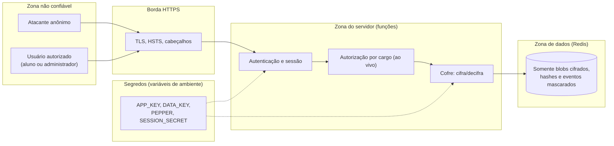
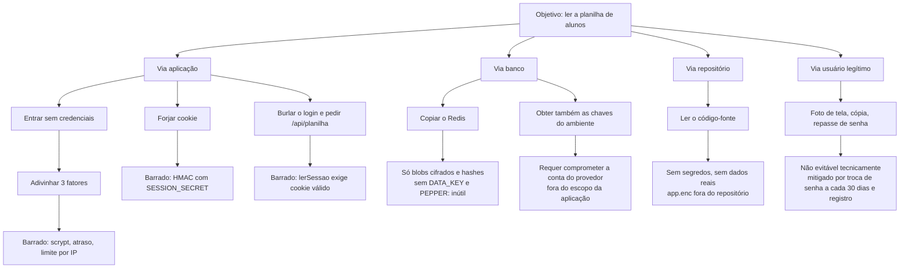
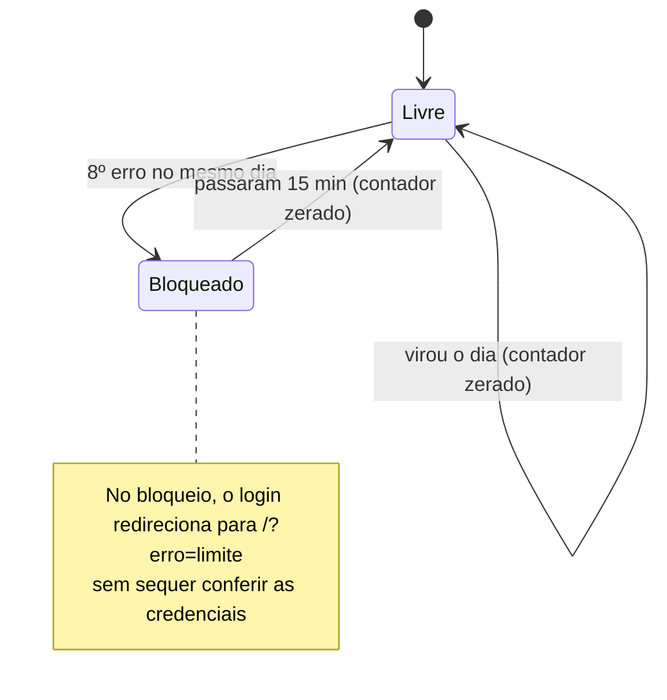
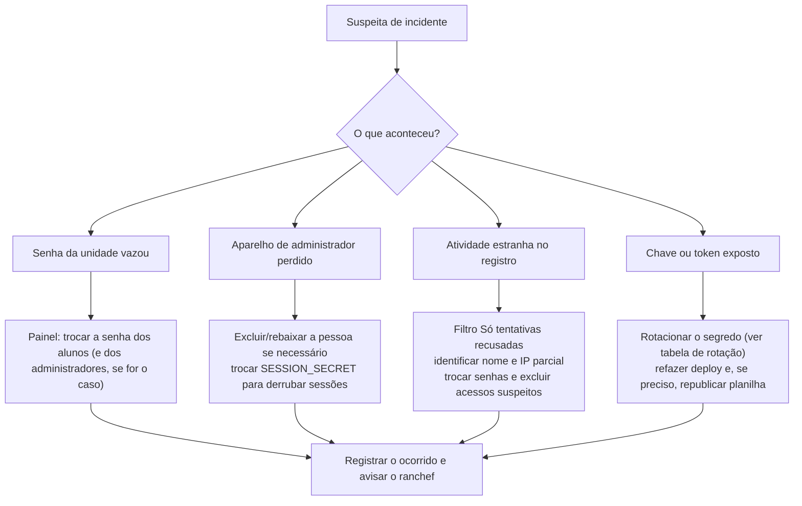

# Segurança

Documento técnico do esquema de segurança: ativos, modelo de ameaças, controles por camada, gestão de segredos, resposta a incidentes e riscos residuais. A criptografia em si (algoritmos, parâmetros e formatos) está em [CRIPTOGRAFIA.md](CRIPTOGRAFIA.md); os fluxos, em [ARQUITETURA_E_FLUXO.md](ARQUITETURA_E_FLUXO.md).

## Sumário

1. [Escopo e premissas](#1-escopo-e-premissas)
2. [Ativos a proteger](#2-ativos-a-proteger)
3. [Modelo de ameaças](#3-modelo-de-ameaças)
4. [Autenticação](#4-autenticação)
5. [Sessão](#5-sessão)
6. [Autorização](#6-autorização)
7. [Proteção contra abuso e força bruta](#7-proteção-contra-abuso-e-força-bruta)
8. [Proteções do navegador e do HTTP](#8-proteções-do-navegador-e-do-http)
9. [Riscos residuais e limitações](#9-riscos-residuais-e-limitações)
10. [Registro, privacidade e LGPD](#10-registro-privacidade-e-lgpd)
11. [Gestão de segredos](#11-gestão-de-segredos)
12. [Resposta a incidentes](#12-resposta-a-incidentes)
13. [Checklist de segurança](#13-checklist-de-segurança)

---

## 1. Escopo e premissas

- **Escopo:** o site (login, painel, API), o armazenamento (Redis) e a entrega do app. O app que roda no navegador processa a planilha **localmente**.
- **Usuários:** um grupo pequeno e conhecido (dezenas de pessoas), com 3 níveis de cargo.
- **Dados:** nomes, turmas e marcações de presença em refeições de alunos. Não são dados sensíveis no sentido do art. 5º, II, da LGPD, mas são **dados pessoais** e recebem tratamento de dados sensíveis neste projeto (cifragem, retenção mínima, acesso restrito).
- **Premissas:** o provedor de hospedagem e o Redis são confiáveis quanto à disponibilidade e ao isolamento entre clientes; as variáveis de ambiente são protegidas por quem administra a conta; o usuário **autorizado** é confiável para ver os dados que o app lhe mostra.

---

## 2. Ativos a proteger

| Ativo | Impacto se comprometido | Principais controles |
|---|---|---|
| Planilha publicada (nomes, turmas, marcações) | Exposição de dados pessoais | Cifragem AES-256-GCM, TTL de 14 dias, só entregue a quem está autenticado, o arquivo original não é guardado |
| Rascunhos | Exposição do trabalho individual | Cifragem por pessoa, TTL de 7 dias, acessível só ao dono (e, agregado pela Conferência Geral, aos usuários autenticados) |
| Números internos e senhas | Personificação de usuários | Hash scrypt + HMAC com `PEPPER`; nunca em texto; exibição no painel só para ranchef e administradores, cifrada em repouso |
| Contas de administrador | Alteração da lista, troca de senhas | Senha própria, sessão curta (2 h), cargo conferido ao vivo, confirmação com o número interno, limites |
| O próprio app | Cópia do código | Cifrado em repouso e entregue só após o login (não é segredo crítico, mas é protegido) |
| Registro de eventos | Vazamento de IP/nomes; adulteração | IP mascarado, retenção de 30 dias, somente o servidor escreve |
| Segredos (`APP_KEY`, `DATA_KEY`, `PEPPER`, `SESSION_SECRET`, token do Redis) | Quebra de todas as camadas acima | Só no ambiente do servidor; nunca no repositório ou no banco |

---

## 3. Modelo de ameaças

### 3.1 Fronteiras de confiança

Três fronteiras importam: (1) **internet → borda** (TLS, limites, validação de origem); (2) **sessão → cargo** (nenhuma decisão de autorização confia só no cookie); (3) **servidor → banco** (nada legível é gravado; as chaves não estão no banco).

### 3.2 Ameaças e respostas (STRIDE)

| # | Ameaça | Categoria | Controle principal | Residual |
|---|---|---|---|---|
| T1 | Adivinhar nome + número interno + senha por tentativas | Falsificação de identidade | 3 fatores de conhecimento, scrypt, atraso de 0,8 s, 8 erros/dia/IP → 15 min, mensagem genérica | Baixo (contador por instância) |
| T2 | Enumerar usuários pelo tempo de resposta | Divulgação de informação | Mesmo custo de hash para nome inexistente; mensagem única | Baixo |
| T3 | Roubo de cookie de sessão | Falsificação | `HttpOnly`, `Secure`, `SameSite=Strict`, expiração curta, HSTS | Médio se o aparelho for comprometido |
| T4 | Forjar/alterar o cookie | Adulteração | Assinatura HMAC-SHA256 + `timingSafeEqual` | Baixo |
| T5 | CSRF em ações de administrador | Adulteração | `SameSite=Strict`, checagem de `Sec-Fetch-Site`/`Origin`, ações só por `POST` | Baixo |
| T6 | Aluno tentando virar administrador | Elevação de privilégio | Cargo conferido no banco a cada ação; modo administrador exige escolha explícita e a função; tentativas negadas são registradas | Baixo |
| T7 | Administrador tomando o controle de outros | Elevação de privilégio | Só o ranchef promove/rebaixa/troca a senha dos administradores; ninguém altera a si mesmo; transferência atômica | Baixo |
| T8 | Roubo do banco | Divulgação | Dados cifrados; hashes com `PEPPER`; nenhuma chave no banco | Nome de guerra, cargo e eventos (IP parcial) ficam legíveis |
| T9 | Alteração do banco por quem tem escrita | Adulteração | GCM detecta adulteração dos blobs; contexto amarrado | Troca de blobs `k` entre pessoas é possível (ver CRIPTOGRAFIA §12) |
| T10 | Acesso ao app sem login | Divulgação | O HTML só existe cifrado; `/app` exige sessão válida e pessoa ainda existente | Baixo |
| T11 | Injeção/XSS em nomes ou campos | Adulteração | Escape de HTML (`esc`) em todas as páginas do servidor; CSP `script-src 'self'` sem inline nas páginas do servidor; registro limpa caracteres de controle | Baixo nas páginas do servidor; o app usa `unsafe-inline` (ver §8) |
| T12 | Negar o serviço (excesso de requisições) | Negação de serviço | Limites por IP/pessoa, tamanhos máximos (planilha 1,5 MB, rascunho 400 KB, 500 pessoas) | Depende do firewall do provedor |
| T13 | Exfiltração pelo próprio app | Divulgação | CSP `connect-src 'self'` (o app não fala com outros domínios) | Usuário autorizado pode copiar o que vê |
| T14 | Negar autoria de uma ação | Repúdio | Registro com quem, ação, hora, aparelho e IP parcial | Sem login individual forte (nome + número interno) |
| T15 | Vazamento de segredos pelo repositório | Divulgação | `.gitignore` e `.vercelignore` bloqueiam arquivos sensíveis; dados reais fora dos testes; segredos só no ambiente | Depende de disciplina (ver §13) |
| T16 | Pessoa não autorizada lendo o que as conferentes marcaram | Divulgação | `/api/conferencia-geral` exige sessão válida e pessoa ainda na lista; devolve só o agregado (nunca o rascunho bruto); rascunhos continuam cifrados e individuais; consulta registrada | Todo usuário autenticado vê as marcações agregadas e quem conferiu (decisão da operação) |

### 3.3 Caminhos de ataque considerados

---

## 4. Autenticação

O login exige **três informações**, todas validadas no servidor (`api/login.js`):

| Fator | Natureza | Conferência |
|---|---|---|
| Nome de guerra | Identificador | Normalizado (sem acento, minúsculo, espaços compactados) e procurado em `usuarios` |
| Número interno (`[BMN]\d{4}`) | Segredo individual | `scrypt(HMAC-SHA256(PEPPER, código))` vs hash do banco, em tempo constante |
| Senha da unidade | Segredo do perfil | Senha dos **alunos** ou dos **administradores**, conforme o modo escolhido; hash do banco ou variável de ambiente |

Regras adicionais:

- **Escolha do perfil:** a tela de login tem "Entrar como: Aluno | Administrador". Escolher Administrador exige (1) a senha dos administradores e (2) ter a função; caso contrário a tentativa é negada e registrada (`admin_negado`).
- **Fail-closed:** sem senha definida para um perfil, ninguém entra nele (inclusive por falha de configuração, como o nome errado da variável).
- **Lista fechada:** quem não está em `usuarios` não entra, mesmo conhecendo a senha da unidade.
- **Exclusão imediata:** `removido()` é verificado em `/app`, `/api/planilha` e `/api/rascunho`; uma pessoa excluída perde a sessão na hora.
- **Mensagens:** uma só ("Nome, número interno ou senha incorretos").
- **Contas extras (`USERS`)** (opcional): hash scrypt por conta, comparação em tempo constante e hash fictício para usuário inexistente.

---

## 5. Sessão

| Atributo | Valor |
|---|---|
| Mecanismo | Cookie `sessao`: `Base64URL(JSON).Base64URL(HMAC-SHA256)` |
| Flags | `HttpOnly; Secure; SameSite=Strict; Path=/` |
| Duração | **12 h** (aluno) · **2 h** (administrador) |
| Conteúdo | `u` (nome), `r` (papel de reserva), `m` (modo administrador 0/1), `exp` |
| Renovação | Não há renovação deslizante: ao expirar, é preciso entrar de novo |
| Encerramento | `/sair` apaga o cookie (`Max-Age=0`) e registra o evento |
| Invalidação em massa | Trocar `SESSION_SECRET` |

O **modo administrador** (`m = 1`) só é gravado quando a pessoa escolheu "Administrador" e tem a função; **sem ele, nenhum poder de administrador é concedido** (`papelAtual` retorna 0), mesmo que o cargo no banco seja de administrador. Para trocar de modo é preciso sair e entrar de novo.

---

## 6. Autorização

### 6.1 Princípios

1. **Cargo ao vivo:** `pessoas.papelAtual(nome, sessão)` lê o cargo no banco **a cada requisição** de painel e de ação; o papel do cookie só é usado como reserva se o banco falhar.
2. **Negar por padrão:** qualquer rota administrativa sem cargo suficiente responde 403 e registra `admin_negado`.
3. **Menor privilégio:** ações que mexem em administradores são **exclusivas do ranchef** (`SO_RANCHEF`).
4. **Confirmação de identidade:** trocar senha, transferir ou assumir o cargo exige o **número interno** de quem executa.
5. **Sem autoalteração:** ninguém se exclui, rebaixa ou promove a si mesmo.

### 6.2 Matriz (rota × cargo)

| Rota | Anônimo | Aluno | Administrador | Ranchef |
|---|:--:|:--:|:--:|:--:|
| `/`, `/api/login` | ✅ | ✅ | ✅ | ✅ |
| `/app`, `/ajuda`, `GET /api/planilha`, `/api/rascunho`, `/api/evento`, `/api/conferencia-geral` | ❌ | ✅ | ✅ | ✅ |
| `/admin`, `/admin/planilha`, `/api/admin-lista` | ❌ | ❌ | ✅ (modo admin) | ✅ (modo admin) |
| `POST/DELETE /api/planilha` | ❌ | ❌ | ✅ | ✅ |
| `/api/admin-acao` (cadastrar, remover, planilha, senha dos alunos) | ❌ | ❌ | ✅ | ✅ |
| `/api/admin-acao` (promover, rebaixar, senha dos administradores, transferir) | ❌ | ❌ | ❌ | ✅ |
| `/api/admin-acao` (assumir ranchef, só se não há ranchef) | ❌ | ❌ | ✅ | — |
| `/api/admin-exportar` (backup) | ❌ | ❌ | ❌ | ✅ |

### 6.3 Exposição do número interno no painel

Para conferência, o painel mostra o número interno ao lado do nome, **cifrado em repouso** e decifrado só no servidor:

| Quem vê | O que vê |
|---|---|
| Ranchef | O número de **todos** |
| Administrador | O número de **todos** (decisão da operação: os administradores conferem todos os números cadastrados) |
| Aluno | Nada (não acessa o painel) |

A busca por número interno no registro retorna **só alunos**, nunca administradores.

---

## 7. Proteção contra abuso e força bruta

| Controle | Escopo | Regra | Onde |
|---|---|---|---|
| Atraso fixo em erro de login | por tentativa | ~0,8 s | `login.js` |
| Limite de erros de login | por IP | **8 erros por dia** (contador zera à meia-noite de Brasília); no 8º erro, **bloqueio de 15 min** e o contador volta a zero | `seguranca.js` (`bloqueado`/`falhou`) |
| Custo do hash | por tentativa | scrypt N = 16384 | `seguranca.js` |
| Troca de senha / transferir / assumir | por pessoa | 5 tentativas por 15 min | `admin-acao.js` |
| Busca por número interno | por pessoa | 20 consultas por 15 min | `admin.js` |
| Tamanhos máximos | por requisição | planilha 1,5 MB e 3.000 alunos; rascunho 400 KB; 500 pessoas | `planilha.js`, `rascunho.js`, `pessoas.js` |
| Lista fechada de eventos | `/api/evento` | só 3 ações permitidas | `evento.js` |

> **Limitação:** os contadores ficam **em memória por instância** do servidor serverless; instâncias diferentes têm contagens diferentes. Complemente com o *rate limit* do firewall do provedor em `/api/login`.

---

## 8. Proteções do navegador e do HTTP

### 8.1 Cabeçalhos globais (`vercel.json`)

| Cabeçalho | Valor | Efeito |
|---|---|---|
| `Strict-Transport-Security` | `max-age=63072000; includeSubDomains; preload` | Força HTTPS |
| `X-Content-Type-Options` | `nosniff` | Sem adivinhação de tipo de conteúdo |
| `X-Frame-Options` | `DENY` | Sem *clickjacking* |
| `Referrer-Policy` | `same-origin` | Não vaza URL a outros sites |
| `Permissions-Policy` | `camera=(), microphone=(), geolocation=()` | Bloqueia sensores |
| `Cache-Control` | `no-store` | Nada de cópia em cache do navegador/proxy |

### 8.2 Content Security Policy

| Contexto | Política |
|---|---|
| Páginas do servidor (painel, ajuda, visualizador) | `default-src 'none'; style-src 'self'; img-src 'self'; script-src 'self'; form-action 'self'; base-uri 'none'; frame-ancestors 'none'` — **sem scripts ou estilos inline** |
| O app (`/app`) | `default-src 'self'; script-src 'self' 'unsafe-inline' 'unsafe-eval' blob:; style-src 'self' 'unsafe-inline'; img-src 'self' data: blob:; font-src 'self' data:; worker-src 'self' blob:; connect-src 'self' data: blob:; frame-ancestors 'none'; form-action 'self'` |

O app precisa de `'unsafe-inline'`/`'unsafe-eval'` porque é **um HTML único** com `pdf.js`, `xlsx` e `jspdf` embutidos. O risco é contido porque: não há conteúdo de terceiros, o HTML vem cifrado do próprio servidor, e `connect-src 'self'` impede o envio de dados a outros domínios.

### 8.3 CSRF

Camadas independentes: cookie `SameSite=Strict`; `mesmaOrigem(req)` (aceita `Sec-Fetch-Site: same-origin|none`; sem esse cabeçalho, compara `Origin` com `Host`; `Origin: null` só é aceito com `Sec-Fetch-Site` válido); e todas as ações que alteram estado são `POST`/`PUT`/`DELETE`. `/sair` é um `GET` inofensivo (apenas encerra a própria sessão).

### 8.4 Saída segura (XSS)

Todo texto dinâmico das páginas do servidor passa por `esc()` (`& < > " '`). O registro remove caracteres de controle de nomes, aparelho e IP.

---

## 9. Riscos residuais e limitações

| # | Risco / limitação | Probabilidade | Impacto | Mitigação existente | Melhoria possível |
|---|---|:--:|:--:|---|---|
| R1 | Usuário autorizado faz foto/cópia ou repassa a senha | Média | Médio | Troca de senha a cada 30 dias, registro de downloads | Marca d'água por usuário, controles organizacionais |
| R2 | Contadores de tentativa por instância | Média | Baixo | Atraso, scrypt, `PEPPER`, três fatores | Contadores no Redis; *rate limit* do firewall |
| R3 | Número interno com poucas combinações | Baixa | Médio | Depende também de nome e senha; limites; `PEPPER` | Segundo fator forte (TOTP) |
| R4 | Troca de blobs `k` por quem tem **escrita** no banco | Muito baixa | Baixo | Não permite leitura; exige acesso privilegiado | AAD por pessoa no campo `k` |
| R5 | Segredos perdidos (`DATA_KEY`, `APP_KEY`, `PEPPER`) | Baixa | Alto (indisponibilidade) | Orientação de guardar em gerenciador de senhas | Procedimento formal de custódia |
| R6 | Banco indisponível → ninguém entra | Baixa | Médio | App segue cifrado; falha segura | Cache de leitura de curta duração |
| R7 | Cookie roubado de um aparelho comprometido | Baixa | Médio | Sessões curtas, `HttpOnly`, `SameSite=Strict`, botão Sair | Vincular sessão a aparelho |
| R8 | CSP do app com `unsafe-inline`/`unsafe-eval` | Baixa | Médio | Sem terceiros, `connect-src 'self'`, HTML cifrado e próprio | Separar bibliotecas em arquivos estáticos com hash (SRI) |
| R9 | Nome de guerra e cargo legíveis no banco | Baixa | Baixo | Acesso ao banco restrito por token | Cifrar o nome com índice cego (HMAC) |
| R10 | Sem auditoria de segurança externa | — | — | 38 testes de segurança/regra, revisão interna | Pentest independente antes de ampliar o uso |
| R11 | Administradores veem o número interno do ranchef e dos demais; como a senha dos administradores é compartilhada, um administrador mal-intencionado poderia entrar como outra pessoa (inclusive o ranchef) | Baixa | Alto | Decisão consciente; sessão de administrador de 2 h; todas as entradas e ações ficam no registro; troca da senha dos administradores só pelo ranchef | Senha individual por administrador ou segundo fator (TOTP) |

---

## 10. Registro, privacidade e LGPD

- **Finalidade:** controle de acesso e auditoria operacional (quem fez o quê e quando).
- **Minimização:** o registro guarda `t` (horário), `u` (nome), `a` (ação), `ip` (**mascarado**: `187.12.x.x`; IPv6: três primeiros grupos), `ua` (aparelho, 160 caracteres) e, em ações de administrador, `alvo`. **Nunca**: senha, número interno digitado, conteúdo da planilha, nomes de alunos.
- **Retenção:** até 5.000 eventos e **30 dias** (limpeza no login).
- **Planilha e rascunho:** cifrados e temporários (14 e 7 dias); o arquivo original não é guardado.
- **Transparência:** informe os usuários de que os acessos são registrados.
- **Direitos do titular:** a exclusão da pessoa da lista remove o acesso e os dados dela do banco (`HDEL usuarios`); o rascunho expira sozinho; os eventos expiram em 30 dias.
- **Segregação:** o painel de eventos só abre para administradores em modo administrador, e cada consulta é registrada como `admin_consulta` (não exibida na lista).

---

## 11. Gestão de segredos

| Segredo | Geração | Guarda | Rotação sugerida |
|---|---|---|---|
| `APP_KEY`, `DATA_KEY` | `crypto.randomBytes(32).toString('hex')` | Variável de ambiente + gerenciador de senhas | Só em caso de suspeita (a rotação tem custos: ver [CRIPTOGRAFIA.md](CRIPTOGRAFIA.md#10-rotação-e-recuperação)) |
| `PEPPER` | Aleatório longo | Idem | **Evitar** (invalida todos os códigos) |
| `SESSION_SECRET` | Aleatório longo | Idem | Quando necessário (derruba sessões) |
| Token do Redis | Gerado no provedor | Variável de ambiente | Em caso de suspeita ou saída de pessoas com acesso |
| Senhas de acesso | Escolhidas pelo ranchef/administradores (8–64 caracteres) | Painel (hash no banco) | **A cada 30 dias** |

Regras: nunca enviar segredos por chat ou e-mail; nunca em arquivos versionados; scripts que usam segredos (`carregar-lista.mjs`) os leem de variáveis **da janela do terminal**, sem gravar em disco.

---

## 12. Resposta a incidentes

Se algum dado real (planilha, lista de autorizados, banco, segredo) for **enviado por engano ao repositório**: considere-o **exposto**; remova do histórico (`git filter-repo`) ou apague e recrie o repositório; troque os segredos envolvidos e avise o responsável.

---

## 13. Checklist de segurança

**Antes de publicar**
- [ ] `APP_KEY`, `DATA_KEY`, `PEPPER`, `SESSION_SECRET` definidos e **diferentes** entre si.
- [ ] `ACCESS_CODE` e `ACCESS_CODE_ADMIN` definidos e diferentes; trocar pelo painel logo no início.
- [ ] `dados/app.enc` gerado com a mesma `APP_KEY` do servidor.
- [ ] Banco Redis conectado, com o token somente nas variáveis de ambiente.
- [ ] `AUTORIZADOS.txt` **fora** do repositório e carregado com `carregar-lista.mjs`.

**No repositório**
- [ ] `git status` e `git diff --cached --stat` conferidos antes de cada commit.
- [ ] Sem planilhas reais, listas de autorizados, backups, `.env`, `dados/app.enc` ou bancos.
- [ ] Testes só com dados fictícios; `npm run teste:tudo` passando.

**Rotina**
- [ ] Trocar a senha dos alunos **a cada 30 dias** (o painel avisa).
- [ ] Revisar o registro com **"Só tentativas recusadas"** periodicamente.
- [ ] Excluir o acesso de quem saiu da equipe no mesmo dia.
- [ ] Manter o backup da lista (ranchef) e os segredos num gerenciador de senhas.
- [ ] Ativar o *rate limit* do firewall do provedor em `/api/login`.
